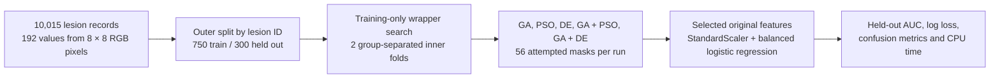
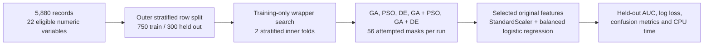
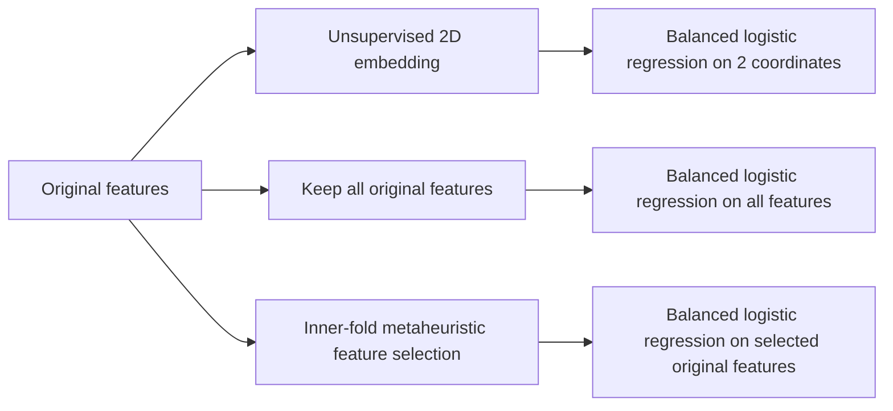

# Methodology diagrams

The presentation contains editable versions of these diagrams. The first two workflows use the same experiment sizes but different split rules. In both, feature selection and standardization use training records only.

## HAM10000

Related images from the same lesion stay on one side of the outer split. The inner folds also keep lesion groups separate. The positive label is melanoma.

## Blood-cell anomaly table

The table has no patient identifier, so this row split cannot test generalization to new patients. The positive label is anomaly.

## Which models can be compared directly?

The direct feature-selection comparison is **all features versus each selected-feature model on the same outer split**. The earlier two-dimensional embedding study changes the feature representation and is a separate experiment. Every path ends in a balanced logistic-regression classifier, but the inputs differ.

| Dataset | Full features: AUC / count / CPU s | Best setting-A selector: AUC / count / CPU s |
|---|---|---|
| HAM10000 | 0.713 / 192 / 0.08 | GA + PSO: 0.735 / 40 / 0.98 |
| Blood cells | 0.809 / 22 / 0.02 | DE: 0.813 / 10.7 / 0.41 |

Values are means of three shared outer splits. CPU times are process seconds on one machine. The AUC differences are small relative to split variation; three overlapping splits do not establish superiority. See [`METAHEURISTIC_FEATURE_SELECTION.md`](METAHEURISTIC_FEATURE_SELECTION.md) for the objective, metrics, parameters and limitations.
