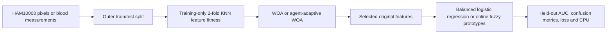

# RLWOA-SOFL paper adaptation on the two project datasets

## Source and scope

Ahmed M. Anter and Zhiguo Zhang, “RLWOA-SOFL: A New Learning Model-Based Reinforcement Swarm Intelligence and Self-Organizing Deep Fuzzy Rules for fMRI Pain Decoding,” *IEEE Transactions on Affective Computing* (2023), DOI [10.1109/TAFFC.2023.3285997](https://doi.org/10.1109/TAFFC.2023.3285997). The supplied paper studied multi-level pain perception from fMRI. This repository has **neither its fMRI data nor its reference implementation**. The code here is a documented adaptation to binary melanoma and blood-cell anomaly endpoints. It must not be described as a reproduction of the published accuracy or a clinical validation.

## Concepts in the paper

1. **WOA, whale optimization algorithm.** Each agent encodes a feature subset. A search agent moves toward the current best (encircling), explores around another agent, or follows a spiral path. The coefficient `a` usually falls from 2 to 0, shifting exploration toward exploitation. A sigmoid transfer converts continuous positions to binary feature masks.
2. **Feature fitness.** The paper's Eq. 14 is five-neighbor KNN accuracy plus `alpha × (1 − selected/total)`. Its published experiment uses `alpha = 0.8`. The second term rewards compact subsets; a large alpha can favor tiny masks even when predictive information is lost.
3. **RLWOA.** Rather than impose the same linear exploration schedule on all agents, the paper stores each agent's recent fitness improvements or deterioration as its state. An action increases, decreases, or keeps that agent's exploration/exploitation rate. A positive or negative reward updates a BPNN state-action map. This makes search behavior depend on each agent's experience.
4. **SOFL.** The paper uses class-specific, self-organizing AnYa-type fuzzy prototypes. Training records update prototype densities and local regions; fuzzy rules aggregate their evidence to classify a new observation. Its granularity controls model detail, cost, and potential overfitting.
5. **Original pipeline.** Pain-evoked fMRI preprocessing and feature extraction → RLWOA voxel selection → multi-layer SOFL → multi-level pain prediction. The paper's brain-region interpretation and 0–10 pain labels are specific to fMRI and do not apply to HAM10000 or blood cells.

The paper describes 31 participants with 40 trials each (1,240 observations) and 56,260 candidate voxels. Its fMRI preparation includes motion and slice-time correction, spatial alignment/smoothing, and high-pass filtering. It then extracts onset and peak BOLD responses, normalizes the peak, screens voxels by correlation, and applies empirical mode decomposition. At its reported granularity level 7, it lists accuracy 0.9073, sensitivity 0.8988, specificity 0.9906, and F1 0.8872. Those values describe a different modality, endpoint, and validation setup and cannot be used as a numeric target for this project.

## Implemented adaptation



- **Data:** HAM10000 uses 192 downsampled RGB pixel values and `lesion_id` group-separated outer and inner splits. The blood table uses 22 eligible measured variables and stratified row splits; it has no patient identifier. Positive labels are melanoma and anomaly, respectively. Training/test sizes are 750/300 for each of three shared seeds.
- **Search:** `src/paper_rlwoa_sofl.py` implements 5 agents × 20 iterations, hence 105 attempted fitness calls per search. Both standard WOA and adaptive WOA use the same KNN fitness and budget. Fitness is calculated only on two training folds; scaling is fitted within each fold. Standard WOA uses linear `a`. The adaptive version gives each agent its own three-action neural policy, recent three fitness-change signs, ±1 reward, and online policy-gradient update. This is a **small explicit approximation** of the paper's BPNN/repository-experience controller; the paper does not provide enough implementation detail to assert identical policy training.
- **Classifier:** the selected features feed either the existing class-balanced logistic regression or an online, class-specific cosine-prototype fuzzy classifier. The latter creates a prototype when a new sample is farther than `radius=0.25` from its nearest class prototype, otherwise updates that prototype. The nearest similarity for each class is softened into probabilities. This captures the self-organizing prototype idea, but **does not implement every AnYa density, granularity layer, or recursive rule equation** in the paper. `Full + fuzzy` is an ablation with the same fuzzy classifier and all features.
- **Evaluation:** the exact same held-out records are used across these four paths. AUC, accuracy, error, sensitivity/recall, specificity, precision, F1, kappa, informedness, markedness, log loss, confusion counts, selected feature count, trajectory, and process CPU time are saved per run. The test set is never used for selecting a mask or policy action. FROC is unavailable because neither table contains detection locations and scored candidates.

## Reproduce

```powershell
python data/download_data.py
python src/paper_rlwoa_sofl.py --seeds 3 --train-n 750 --test-n 300 --agents 5 --iterations 20 --alpha 0.8
python src/paper_rlwoa_sofl.py --seeds 3 --train-n 750 --test-n 300 --agents 5 --iterations 20 --alpha 0.2 --output results/paper_rlwoa_sofl_alpha02
python src/plot_paper_adaptation.py
```

The first run uses the source paper's alpha. The second is an explicitly exploratory sensitivity analysis, not a test-set-tuned setting. Output tables and figures are under `results/paper_rlwoa_sofl/`; the alpha 0.2 run has its own directory.

## Reading the results

### Measured pilot, three outer splits

| Dataset | Alpha | Model | Mean ROC AUC | Mean selected features | Mean CPU seconds |
|---|---:|---|---:|---:|---:|
| HAM10000 | 0.8 | WOA + LR | 0.714 | 22.7 / 192 | 1.11 |
| HAM10000 | 0.8 | Adaptive WOA + LR | 0.733 | 17.3 / 192 | 1.06 |
| HAM10000 | 0.8 | Adaptive WOA + fuzzy | 0.744 | 17.3 / 192 | 1.02 |
| HAM10000 | 0.8 | Full + fuzzy | 0.756 | 192 / 192 | 0.05 |
| Blood cell | 0.8 | WOA + LR | 0.720 | 2.7 / 22 | 0.89 |
| Blood cell | 0.8 | Adaptive WOA + LR | 0.701 | 3.0 / 22 | 0.92 |
| Blood cell | 0.8 | Adaptive WOA + fuzzy | 0.734 | 3.0 / 22 | 0.92 |
| Blood cell | 0.8 | Full + fuzzy | 0.916 | 22 / 22 | 0.04 |
| HAM10000 | 0.2 | Adaptive WOA + fuzzy | 0.708 | 20.7 / 192 | 2.02 |
| Blood cell | 0.2 | Adaptive WOA + fuzzy | 0.895 | 5.7 / 22 | 1.97 |

The paper's high sparsity weight encourages exceptionally small blood-cell masks, and the fuzzy model loses substantial discrimination relative to all 22 features. Reducing alpha from 0.8 to 0.2 retains about three more blood variables on average and raises its measured AUC from 0.734 to 0.895. That is a **sensitivity observation**, not a tuned performance claim. The HAM fuzzy path moves in the opposite direction (0.744 to 0.708); a single penalty cannot be assumed best across datasets. Full-feature fuzzy has the highest mean AUC in both datasets here, and it avoids search CPU cost. On HAM10000 the differences among the four paths are modest relative to run variation; on blood cells alpha 0.8 gives a clear practical failure of aggressive sparsity. CPU measurements are process time on this workstation and vary with runtime conditions.

The search-convergence plot shows the **inner KNN-plus-sparsity objective**, not held-out AUC or a classifier training loss. An upward trajectory only establishes that the search found a better value of its own objective. The ROC plot uses the first held-out split; the summary table reports all three splits. The large blood-cell gap demonstrates why both views and the confusion metrics should accompany a search convergence curve.

The main comparison is **WOA + logistic regression vs adaptive WOA + logistic regression**, which isolates the learned search controller. Compare **adaptive WOA + logistic regression vs adaptive WOA + fuzzy** to examine classifier choice with an identical selected mask. Compare **adaptive WOA + fuzzy vs full + fuzzy** to assess what feature selection costs or saves for the fuzzy classifier. The earlier GA/PSO/DE study uses a different fitness and budget; its AUC can provide context, but its optimizer ranking is not a controlled equal-budget comparison with this study.

Three overlapping outer splits are a pilot, not independent clinical cohorts. Paired t and Wilcoxon values in `exploratory_tests.csv` are descriptive and should not be treated as evidence of superiority. A proper follow-up needs more independent, patient-level or external validation, tuning confined to inner folds, and a reference SOFL implementation if exact paper replication is the research goal.
